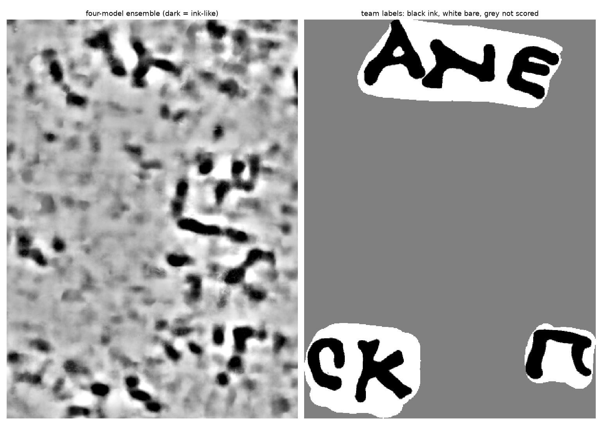
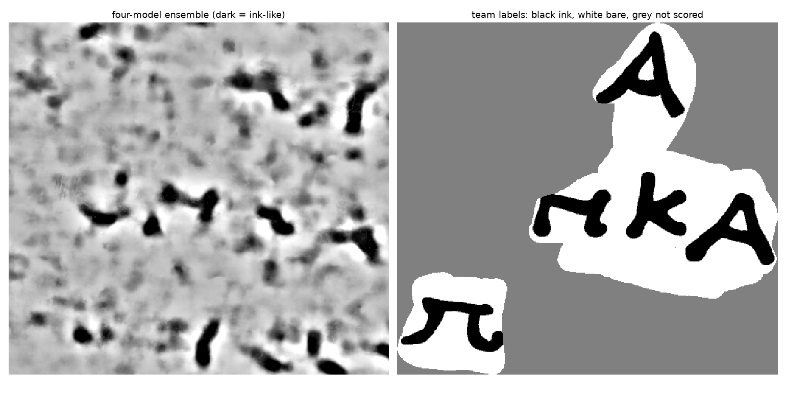

On the team's own surfaces of PHerc. 0841, the recipe's four ink models find the labelled ink (AUC 0.75 and 0.72 against a floor of 0.53) but do not draw readable letters (2026-11-13)

Finding 111. PHerc. 0841 is a scroll with published, labelled segments; it is not prize-eligible. The question was
whether the First Letters recipe's ink step (four released 9 µm models, averaged) shows known ink on a correct
surface of a scroll outside the ink_9um training list, because that decides what a blank image on an eligible scroll
would mean. The surfaces are the team's published meshes on the 9.366 µm scan, so no fit was involved. Registered
before any ink model ran on a PHerc. 0841 render:
`docs/preregistration/2026-11-13_first_letters_0841_surface_control.md` (commit `3e3487f8`). Record:
`reports/first_letters_0841_surface_control.json`. Scripts as run: `repro/first_letters/pherc0841/`.

**Verdict `BLOB_LEVEL_SIGNAL`**, by the registered table: every step exited 0, P1 holds on both held-out segments
and P2 holds on neither. This is the outcome I registered as expected. The margin on P2 is thin on one segment
(0.748 against a line of 0.75), and the section "How firm is the P2 line" says what that is worth.

## The readings

The depth and side were chosen on the development segment and applied unchanged to the other two. The score is
the area under the ROC curve of the four-model ensemble against the team's ink labels, on 4 × 4 pixel cells inside
the team's supervised area.

| segment | role | scored cells (ink) | AUC | floor `F` (map slid 512 px) | other side | P1 | P2 |
|---|---|---|---|---|---|---|---|
| `20260220213127-w00` | development | 97,328 (22,150) | 0.764 | not measured | not measured | | |
| `20260220214732-auto_grown…` | held out | 59,074 (19,876) | **0.748** | 0.526 | 0.556 | holds | fails |
| `20260221022814-auto_grown…` | held out | 77,626 (18,119) | **0.719** | 0.529 | 0.540 | holds | fails |

P1 asked for at least 0.60 and at least 0.05 above the floor; P2 for at least 0.75. For reference, the team's own
ink image, from a model trained on this scroll's 2.4 µm scan, scores 0.921 and 0.869 on the two held-out segments.

**The sweep on the development segment.** One side reads the ink and the other does not. On the `_reverse` side
the AUC rises from 0.645 at depth −8 to 0.764 at depth −2 and falls to 0.578 at depth +8; it is within 0.01 of the
peak from depth −3 to 0. On the forward side it lies between 0.490 and 0.558 at all 17 depths. The chosen setting
is depth −2, `_reverse`.

## What the maps look like

Each figure shows the ensemble at the chosen setting beside the labels, over the box that contains the scored
cells.

My reading of them, which is a judgement and not a measurement: dark strokes sit where the labelled letters are,
and some are stroke-shaped rather than round, but no labelled letter can be read from the map alone. The maps also
carry strokes of similar strength outside the labelled areas. The team labelled only where its own model showed
ink, so those may be unlabelled ink or false positives; this run cannot tell which.

## How firm is the P2 line

None of this was registered, and none of it changes the verdict.

| segment | AUC | spread when 256 px blocks are resampled (2.5% to 97.5%) | best AUC with the map moved up to 6 cells | at (rows, cols) |
|---|---|---|---|---|
| development | 0.764 | 0.711 to 0.818 (43 blocks) | 0.772 | (0, 2) |
| held out `…214732` | 0.748 | 0.682 to 0.800 (28 blocks) | 0.756 | (2, 2) |
| held out `…022814` | 0.719 | 0.642 to 0.772 (37 blocks) | 0.731 | (2, 2) |

- **The 0.75 line is inside the spread on both held-out segments.** The table's verdict depends on which side of
  0.75 a number with a spread of about ±0.06 fell. What the run supports is "AUC about 0.72 to 0.75, far above
  the floor, far below the team's model". It does not separate blob-level from letter-level by that threshold.
- **The labels and the map are in the same place.** In a scan in 8-cell steps out to 128 cells
  (run by hand, not in the record), moving the map by 8 cells drops the AUC to 0.71 or below on every segment,
  and by 64 cells or more to between 0.40 and 0.59. The best position is within 2 cells
  (8 render pixels) of where the map was scored, and worth at most 0.012. With that best position the first
  held-out segment would read 0.756. I did not use it.

**Per model, at the chosen setting.**

| model | development | held out `…214732` | held out `…022814` |
|---|---|---|---|
| dense_native | 0.764 | 0.781 | 0.692 |
| Hecate 9.6 µm | 0.697 | 0.700 | 0.678 |
| ink_9um seed 42 | 0.673 | 0.652 | 0.653 |
| ink_9um seed 43 | 0.682 | 0.657 | 0.673 |

On two of the three segments dense_native alone scores as high as the ensemble or higher. The depth was chosen
for the ensemble, so this is not a fair comparison of the models.

## What it cost

| step | wall time | host memory (peak resident) | GPU peak |
|---|---|---|---|
| render, 66 layers, development (cold CT cache) | 13 min 11 s | not recorded for the container | none |
| render, held out (CT partly cached) | 1 min 50 s, 2 min 55 s | not recorded | none |
| ink, 17 depths, both sides, four models, development | 2 h 21 min 39 s | 5.2 GB | 3.4 GB |
| ink, one depth, per held-out segment | 17 min 32 s, 16 min 10 s | 5.6 GB, 4.7 GB | 3.5 GB, 3.0 GB |

The sweep ran over my projection of under 2 hours. One depth costs about 8 minutes inside a sweep and about
17 minutes run alone. All 68 sweep jobs exited 0. The run directory is 4.8 GB. The training loop was stopped
throughout.

## What this does to the campaign

By the registered consequence: **the first eligible-scroll band goes ahead as a detection test, and a letter
claim needs a better ink step.** In practice:

1. A band on an eligible scroll is read with a depth sweep on both sides. The side matters more than the depth
   here (0.76 against 0.56 at best), and the usable depth window was about four layers wide.
2. A blank band is weak evidence of no ink. On a correct surface with known ink these models reach AUC 0.72 to
   0.75 when the depth is chosen with labels; without labels the choice is harder and the number is an upper bound.
3. Dark strokes on a band are not letters until something sharper than these four models says so. The team's
   0.87 to 0.92 came from a model trained on the scroll's own 2.4 µm scan.

## What this does not show

1. Anything about the mesh half on PHerc. 0841. Its lasagna normal and gradient volumes are not published, so the
   recipe's fit cannot be run there from public inputs.
2. That the three segments are independent. 27% of the development segment's nodes lie within 10 voxels of the
   first held-out segment and 2% of the second. What was held out is the choice of depth and side.
3. That every model was blind to PHerc. 0841. Hecate's card does not list its training scrolls.
4. What a blind depth choice finds. The depth and side were chosen with labels.
5. Anything about fainter ink. Labels cover 4.5% to 8% of each frame, where the team could already see ink.
6. A calibration of 0.75 against legibility. The line was a judgement, and the figures are the evidence for
   "not readable".
7. Variation between runs. Each map was made once; the spread above is over papyrus, not over repeated runs.
